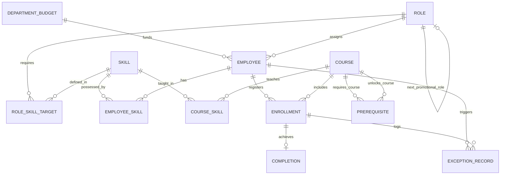

# SkillPath AI – Database Schema Specification

This document provides the complete relational architecture, entity-relationship models, constraints, and field definitions for the 11 core entities and the exception tracking audit table.

---

## 1. Entity-Relationship Diagram

---

## 2. Table Specifications (11 Relational Entities + Audit Table)

### 2.1 `roles`
Defines job titles, departments, and hierarchical career progression ladders.
- **`id`** (`VARCHAR(32)`, PK): Primary key (e.g., `ROL-000001`).
- **`title`** (`VARCHAR(128)`, NOT NULL): Official title (e.g., `Senior Software Engineer`).
- **`department`** (`VARCHAR(64)`, NOT NULL): Department grouping.
- **`level`** (`VARCHAR(32)`, NOT NULL): Seniority tier (`Junior`, `Mid`, `Senior`, `Lead`, `Principal`).
- **`next_role_id`** (`VARCHAR(32)`, FK -> `roles.id`, NULLABLE): Self-referential career promotion target.
- **`description`** (`TEXT`): Role summary.

### 2.2 `skills`
Master catalog of technical, architectural, and operational competencies.
- **`id`** (`VARCHAR(32)`, PK): Primary key (e.g., `SKL-000001`).
- **`name`** (`VARCHAR(128)`, UNIQUE, NOT NULL): Skill name (e.g., `Python`, `Distributed Systems`).
- **`category`** (`VARCHAR(64)`, NOT NULL): Domain (e.g., `Programming`, `Data & AI`, `Cloud & DevOps`).
- **`description`** (`TEXT`): Skill definition.
- **`min_proficiency`** (`INT`, DEFAULT 0): Minimum proficiency index.
- **`max_proficiency`** (`INT`, DEFAULT 5): Maximum proficiency index.

### 2.3 `employees`
Enterprise workforce master records.
- **`id`** (`VARCHAR(32)`, PK): Primary key formatted as `EMP-000001`.
- **`name`** (`VARCHAR(128)`, NOT NULL): Full name.
- **`email`** (`VARCHAR(128)`, UNIQUE, NOT NULL): Corporate email address.
- **`department`** (`VARCHAR(64)`, NOT NULL): Business unit.
- **`role_id`** (`VARCHAR(32)`, FK -> `roles.id`, NOT NULL): Current job role.
- **`hire_date`** (`DATE`, NOT NULL): Date joined organization.
- **`status`** (`VARCHAR(32)`, DEFAULT `'ACTIVE'`): State (`ACTIVE`, `ON_LEAVE`, `TERMINATED`).
- **`created_at`** (`DATETIME`, DEFAULT CURRENT_TIMESTAMP).
- **`updated_at`** (`DATETIME`, DEFAULT CURRENT_TIMESTAMP ON UPDATE CURRENT_TIMESTAMP).

### 2.4 `role_skill_targets` (Bridge Entity)
Defines benchmark competency requirements for each role.
- **`id`** (`VARCHAR(64)`, PK): Bridge ID (`RST-<role_id>-<skill_id>`).
- **`role_id`** (`VARCHAR(32)`, FK -> `roles.id`, NOT NULL).
- **`skill_id`** (`VARCHAR(32)`, FK -> `skills.id`, NOT NULL).
- **`target_proficiency`** (`INT`, NOT NULL): Benchmark required level (1 to 5).
- **`importance_weight`** (`FLOAT`, DEFAULT 1.0): Role criticality multiplier (0.5 to 2.0).
- **`is_mandatory`** (`BOOLEAN`, DEFAULT TRUE): Whether shortfall gates role promotion.
- **`effective_date`** (`DATE`, NOT NULL): Validity start date.
- *Constraints*: Unique `(role_id, skill_id)`, Check `target_proficiency BETWEEN 1 AND 5`.

### 2.5 `employee_skills` (Bridge Entity)
Assessed individual employee skill proficiency records.
- **`id`** (`VARCHAR(64)`, PK): Bridge ID (`ESK-<emp_id>-<skill_id>`).
- **`employee_id`** (`VARCHAR(32)`, FK -> `employees.id`, NOT NULL).
- **`skill_id`** (`VARCHAR(32)`, FK -> `skills.id`, NOT NULL).
- **`current_proficiency`** (`INT`, NOT NULL): Assessed level (0 to 5).
- **`last_assessed_date`** (`DATE`, NOT NULL): Timestamp of latest evaluation.
- **`assessment_type`** (`VARCHAR(64)`, NOT NULL): Evaluation mode (`INITIAL`, `POST_COURSE`, `ANNUAL_REVIEW`).
- **`verified_by`** (`VARCHAR(64)`): Evaluating authority or system exam ID.
- *Constraints*: Unique `(employee_id, skill_id)`, Check `current_proficiency BETWEEN 0 AND 5`.

### 2.6 `courses`
Accredited training programs, certifications, and bootcamps.
- **`id`** (`VARCHAR(32)`, PK): Primary key formatted as `CRS-000001`.
- **`title`** (`VARCHAR(255)`, NOT NULL): Course title.
- **`provider`** (`VARCHAR(128)`, NOT NULL): Education vendor or internal academy.
- **`cost`** (`DECIMAL(10,2)`, NOT NULL): Tuition fee in USD.
- **`duration_hours`** (`INT`, NOT NULL): Instructional hours.
- **`capacity`** (`INT`, NOT NULL): Maximum enrollment seats.
- **`enrolled_count`** (`INT`, DEFAULT 0): Currently reserved seats.
- **`start_date`** (`DATE`, NOT NULL): Schedule start.
- **`end_date`** (`DATE`, NOT NULL): Schedule end.
- **`status`** (`VARCHAR(32)`, DEFAULT `'AVAILABLE'`): (`AVAILABLE`, `IN_PROGRESS`, `COMPLETED`, `EXPIRED`).
- **`description`** (`TEXT`): Curriculum summary.
- *Constraints*: Check `cost >= 0`, `duration_hours > 0`, `capacity > 0`, `end_date >= start_date`.

### 2.7 `course_skills` (Bridge Entity)
Curriculum mapping between courses and imparted skills.
- **`id`** (`VARCHAR(64)`, PK): Bridge ID (`CSK-<course_id>-<skill_id>`).
- **`course_id`** (`VARCHAR(32)`, FK -> `courses.id`, NOT NULL).
- **`skill_id`** (`VARCHAR(32)`, FK -> `skills.id`, NOT NULL).
- **`proficiency_gain`** (`INT`, DEFAULT 1): Expected level increment (+1 to +3).
- **`target_level_taught`** (`INT`, NOT NULL): Target mastery level taught (1 to 5).
- *Constraints*: Unique `(course_id, skill_id)`.

### 2.8 `prerequisites` (Bridge Entity)
Course prerequisite dependency graph.
- **`id`** (`VARCHAR(64)`, PK): Bridge ID (`PRQ-<course_id>-<prereq_id>`).
- **`course_id`** (`VARCHAR(32)`, FK -> `courses.id`, NOT NULL): Dependent advanced course.
- **`prerequisite_course_id`** (`VARCHAR(32)`, FK -> `courses.id`, NOT NULL): Required foundational course.
- **`is_mandatory`** (`BOOLEAN`, DEFAULT TRUE): Strict gating flag.
- *Constraints*: Unique `(course_id, prerequisite_course_id)`, Check `course_id != prerequisite_course_id`.

### 2.9 `enrollments`
Course registration, approval, and training state machine.
- **`id`** (`VARCHAR(64)`, PK): Primary key formatted as `ENR-<employee-id>-<course-id>`.
- **`employee_id`** (`VARCHAR(32)`, FK -> `employees.id`, NOT NULL).
- **`course_id`** (`VARCHAR(32)`, FK -> `courses.id`, NOT NULL).
- **`enrollment_date`** (`DATE`, NOT NULL): Date of application.
- **`status`** (`VARCHAR(32)`, DEFAULT `'PENDING'`): Lifecycle status (`PENDING`, `APPROVED`, `IN_PROGRESS`, `COMPLETED`, `CANCELLED`, `REJECTED`).
- **`approved_by`** (`VARCHAR(64)`, NULLABLE): Approving manager.
- **`approval_date`** (`DATE`, NULLABLE): Date of manager approval.
- **`cost_charged`** (`DECIMAL(10,2)`, DEFAULT 0.00): Billed departmental expenditure.
- *Constraints*: Unique `(employee_id, course_id)`.

### 2.10 `completions`
Verified course completions and post-training examination audit records.
- **`id`** (`VARCHAR(64)`, PK): Primary key formatted as `CMP-2026-000001`.
- **`enrollment_id`** (`VARCHAR(64)`, FK -> `enrollments.id`, UNIQUE, NOT NULL).
- **`completion_date`** (`DATE`, NOT NULL): Date exam submitted.
- **`assessment_score`** (`DECIMAL(5,2)`, NOT NULL): Exam score (0.00% to 100.00%).
- **`reassessment_done`** (`BOOLEAN`, DEFAULT FALSE): Proficiency update gate flag.
- **`previous_proficiency`** (`INT`, NULLABLE): Pre-course skill level.
- **`new_proficiency`** (`INT`, NULLABLE): Post-reassessment verified level.
- **`skill_improvement`** (`INT`, DEFAULT 0): Net competency upgrade.
- **`certificate_url`** (`VARCHAR(255)`, NULLABLE): Cryptographic proof artifact URL.
- *Constraints*: Check `assessment_score BETWEEN 0.00 AND 100.00`.

### 2.11 `budgets`
Departmental annual training capital allocations and ledgers.
- **`id`** (`VARCHAR(64)`, PK): Primary key formatted as `BUD-<department>-2026`.
- **`department`** (`VARCHAR(64)`, UNIQUE, NOT NULL): Department name.
- **`fiscal_year`** (`INT`, DEFAULT 2026, NOT NULL): Active fiscal year.
- **`allocated_amount`** (`DECIMAL(12,2)`, NOT NULL): Total annual grant.
- **`spent_amount`** (`DECIMAL(12,2)`, DEFAULT 0.00, NOT NULL): Utilized expenditure.
- **`remaining_balance`** (`DECIMAL(12,2)`, NOT NULL): Real-time remaining capital.
- **`last_updated`** (`DATETIME`, DEFAULT CURRENT_TIMESTAMP).
- *Constraints*: Check `allocated_amount >= 0`, Check `spent_amount >= 0`.

### 2.12 `exceptions` (Audit & Exception Tracking)
Persistent issue tracking for the 5 mandated exceptional decision states.
- **`issue_id`** (`VARCHAR(32)`, PK): Primary key formatted as `ISS-000001`.
- **`employee_id`** (`VARCHAR(32)`, FK -> `employees.id`, NULLABLE).
- **`course_id`** (`VARCHAR(32)`, FK -> `courses.id`, NULLABLE).
- **`issue_type`** (`VARCHAR(64)`, NOT NULL): Category (`PREREQUISITE_VIOLATION`, `BUDGET_EXCEEDED`, `DUPLICATE_COMPLETION`, `UNASSESSED_GAP`, `COURSE_UNAVAILABLE`).
- **`severity`** (`VARCHAR(32)`, DEFAULT `'MEDIUM'`): (`LOW`, `MEDIUM`, `HIGH`, `CRITICAL`).
- **`expected_result`** (`TEXT`, NOT NULL): Deterministic expected engine behavior.
- **`actual_result`** (`TEXT`, NOT NULL): Intercepted runtime decision.
- **`detection_date`** (`DATETIME`, DEFAULT CURRENT_TIMESTAMP).
- **`resolution_status`** (`VARCHAR(32)`, DEFAULT `'OPEN'`): (`OPEN`, `RESOLVED`, `ACKNOWLEDGED`, `SUPPRESSED`).
- **`notes`** (`TEXT`, NULLABLE): Remediation audit remarks.

---

## 3. Standard ID Conventions

| Entity | ID Format Convention | Example |
|---|---|---|
| Employee | `EMP-000001` | `EMP-000042` |
| Skill | `SKL-000001` | `SKL-000128` |
| Course | `CRS-000001` | `CRS-000055` |
| Role | `ROL-000001` | `ROL-000003` |
| Role Skill Target | `RST-<role_id>-<skill_id>` | `RST-ROL-000001-SKL-000010` |
| Employee Skill | `ESK-<emp_id>-<skill_id>` | `ESK-EMP-000001-SKL-000010` |
| Course Skill | `CSK-<course_id>-<skill_id>` | `CSK-CRS-000001-SKL-000010` |
| Prerequisite | `PRQ-<course_id>-<prereq_id>` | `PRQ-CRS-000002-CRS-000001` |
| Enrollment | `ENR-<employee-id>-<course-id>` | `ENR-EMP-000001-CRS-000005` |
| Completion | `CMP-2026-000001` | `CMP-2026-000115` |
| Budget | `BUD-<department>-2026` | `BUD-ENGINEERING-2026` |
| Exception Issue | `ISS-000001` | `ISS-000004` |
