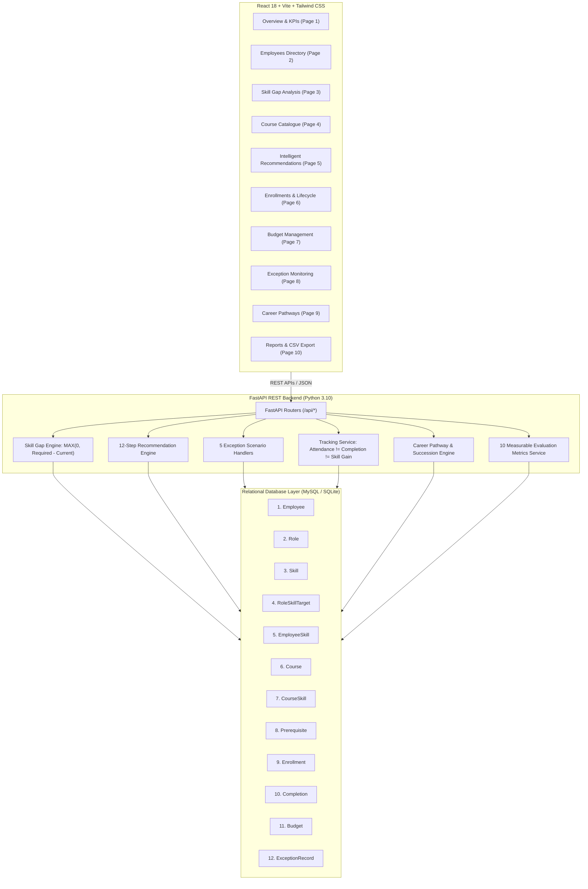

# SkillPath AI – Intelligent Employee Skill Gap Analysis & Learning Recommendation Platform

SkillPath AI is an enterprise-grade platform that identifies employee skill gaps, recommends suitable training courses, verifies prerequisites, checks departmental budgets and availability, creates personalized learning pathways, tracks enrollments and completions, and measures verified post-training skill improvements.

---

## 1. System Architecture



---

## 2. Core Features

1. **Deterministic Skill Gap Analysis**:
   - Calculates exact competency shortfalls using:
     $$\text{Skill Gap} = \max(0, \text{Required Proficiency} - \text{Current Proficiency})$$
   - Classifies gap severity into **Low**, **Medium**, **High**, and **Critical**.
   - Calculates departmental, role-wise, and individual proficiency metrics.

2. **12-Step Intelligent Course Recommendation Engine**:
   - Multi-constraint optimization pipeline evaluating:
     1. Current role
     2. Benchmark skill targets
     3. Current proficiency levels
     4. Missing skills ($\text{gap} > 0$)
     5. Courses covering missing skills
     6. Prerequisite compliance
     7. Schedule validity
     8. Seat availability
     9. Departmental budget remaining
     10. Priority score ranking
     11. Feasible recommendations with natural language explanations
     12. Chronologically ordered learning pathways
   - Rejection tracking: Explains why candidates were rejected (prerequisite violation, budget exceeded, seat capacity, or schedule expiration).

3. **Five Mandated Exception Scenarios (Labelled & Testable)**:
   - **CASE 1**: Prerequisite violation $\rightarrow$ Blocks recommendation/enrollment and records audit issue.
   - **CASE 2**: Budget exceeded $\rightarrow$ Rejects courses exceeding departmental remaining allocation.
   - **CASE 3**: Duplicate completion $\rightarrow$ Intercepts duplicate attempts while safeguarding existing history.
   - **CASE 4**: Skill gap remains without reassessment $\rightarrow$ Holds proficiency unchanged pending examination.
   - **CASE 5**: Course unavailable $\rightarrow$ Filters expired courses out of recommendation pathways.

4. **Auditable Learning Lifecycle & Proficiency Gating**:
   - Strictly enforces: $\text{Attendance} \ne \text{Completion} \ne \text{Skill Improvement}$.
   - Proficiency ratings in `EmployeeSkill` are **only updated upon a verified post-course reassessment score** $\ge 70\%$.

5. **Career Progression & Succession Planning**:
   - Visualizes promotional tracks (e.g., Junior $\rightarrow$ Mid $\rightarrow$ Senior $\rightarrow$ Lead $\rightarrow$ Principal).
   - Computes target role competency gaps, promotion readiness scores, and estimated upskilling investment.

6. **10 Measurable Evaluation Metrics**:
   - Calculated dynamically from database records:
     1. Total skill gaps identified
     2. Skill gaps closed after reassessment
     3. Employee skill improvement
     4. Course completion rate
     5. Department budget utilization
     6. Recommendation acceptance rate
     7. Prerequisite violations intercepted
     8. Duplicate completions prevented
     9. Infeasible recommendations filtered
     10. Average learning duration

7. **Reproducible Synthetic Data Generator**:
   - Seeded with fixed seed `20261022`.
   - Supports both `STARTER` and `FULL` (5,000 employees, 500 skills, 1,000 courses, 10,000 enrollments) modes.
   - Bit-identical reproducibility guaranteed via SHA-256 validation.

---

## 3. Technology Stack

- **Frontend**: React 18, Vite, Tailwind CSS, Recharts, Lucide React icons.
- **Backend**: Python 3.10+, FastAPI, SQLAlchemy 2.0, Pydantic v2, Uvicorn.
- **Database**: MySQL (or zero-config SQLite fallback with foreign keys enabled).
- **Data Processing**: Pandas, NumPy, Faker, Python random with fixed seed `20261022`.
- **Testing & Verification**: Pytest, automated data validator.

---

## 4. Installation & Local Setup

### 4.1 Prerequisites
- Python 3.10+
- Node.js 18+ and npm
- (Optional) MySQL Server 8.0+

### 4.2 Clone and Setup Environment
```bash
# Clone the repository
git clone https://github.com/dinesh548/Skill-Path-AI.git
cd Skill-Path-AI

# Create and activate Python virtual environment
python -m venv venv
# On Windows:
.\venv\Scripts\activate
# On Linux/macOS:
source venv/bin/activate

# Install Python dependencies
pip install -r requirements.txt

# Configure environment variables
cp .env.example .env
```

### 4.3 Database Configuration
The platform supports both MySQL and SQLite:
- **Zero-Config Local Run (Default)**: Uses SQLite database file (`skillpath.db`) with full foreign key constraint enforcement (`PRAGMA foreign_keys=ON;`).
- **MySQL Run**: Set `DATABASE_URL=mysql+pymysql://<user>:<password>@<host>:3306/<database>` in `.env`.

---

## 5. Running the Application

### 5.1 One-Step Master Launch Command
Run the master runner script:
```bash
# Starts backend server (and serves the pre-built React frontend) on http://127.0.0.1:8000
python run.py
```
Open **`http://127.0.0.1:8000`** in your browser to interact with the platform.

### 5.2 Standalone Startup Commands

#### Backend:
```bash
python -m uvicorn backend.app.main:app --host 127.0.0.1 --port 8000 --reload
```
Interactive API documentation: **`http://127.0.0.1:8000/docs`**

#### Frontend (Development Server):
```bash
cd frontend
npm install
npm run dev
```
Development frontend will be available at **`http://127.0.0.1:5173`** (proxies `/api` to port 8000).

---

## 6. Synthetic Data Generation & Validation

### 6.1 Generate Synthetic Data
```bash
# Generate starter dataset and seed database directly:
python run.py --seed --mode STARTER

# Generate full benchmark dataset (5,000 employees, 500 skills, 1,000 courses, 10,000 enrollments):
python backend/generator/generator.py --mode FULL --seed 20261022
```

Outputs generated:
- CSV exports: `data/starter/*.csv` or `data/full/*.csv`
- JSON exports: `data/starter/json/*.json`
- SQL seed file: `data/starter/seed.sql`
- Ground truth exception labels: `data/exports/ground_truth.csv`

### 6.2 Run Automated Data Validation
```bash
python run.py --validate
```
Executes 11 relational integrity and reproducibility checks and outputs `data/exports/validation_report.json`.

---

## 7. Automated Testing

Run the comprehensive Pytest suite:
```bash
# Run all automated tests:
pytest backend/tests -v

# Or via master runner:
python run.py --test
```

Test coverage includes:
- API endpoint health and response schemas.
- Skill gap calculation formulas.
- 12-step course recommendation engine.
- CASE 1: Prerequisite violation interception.
- CASE 2: Department budget exceeding rejection.
- CASE 3: Duplicate completion detection and history preservation.
- CASE 4: Unassessed gap proficiency holding.
- CASE 5: Course unavailability during planning period filtering.
- Career pathway progression calculations.
- Evaluation metrics calculation correctness.

---

## 8. REST API Reference

| Method | Endpoint | Description |
|---|---|---|
| `GET` | `/api/health` | Service health status |
| `GET` | `/api/employees` | Search and filter employee directory |
| `GET` | `/api/employees/{id}` | Retrieve employee profile |
| `POST` | `/api/employees` | Create new employee |
| `GET` | `/api/employees/{id}/skills` | Retrieve assessed employee skills |
| `GET` | `/api/employees/{id}/skill-gaps`| Calculate individual employee skill gaps |
| `GET` | `/api/skills` | Master skill catalog |
| `GET` | `/api/skills/roles` | Role definitions and career ladders |
| `GET` | `/api/courses` | Accredited course catalogue |
| `GET` | `/api/courses/{id}` | Course details, prerequisites, and skills taught |
| `GET` | `/api/recommendations/{employee_id}`| Generate 12-step course recommendations |
| `POST`| `/api/recommendations/generate`| Generate recommendations with planning date |
| `GET` | `/api/enrollments` | List enrollments with lifecycle filter |
| `POST`| `/api/enrollments` | Enroll employee in a course |
| `PATCH`| `/api/enrollments/{id}` | Approve, start, or cancel enrollment |
| `GET` | `/api/completions` | List verified completions |
| `POST`| `/api/completions` | Record course completion and exam score |
| `POST`| `/api/completions/{id}/reassess`| Submit reassessment and upgrade proficiency |
| `GET` | `/api/budgets` | Department budgets and balances |
| `GET` | `/api/budgets/{department}` | Department budget breakdown |
| `GET` | `/api/exceptions` | Audit log of the 5 exception scenarios |
| `PATCH`| `/api/exceptions/{id}/resolve` | Update resolution status of an exception |
| `GET` | `/api/career-pathways/{id}` | Career progression roadmap and readiness % |
| `GET` | `/api/analytics/dashboard` | Dashboard KPIs, charts, and 10 evaluation metrics |
| `GET` | `/api/reports/export/{type}` | Download CSV reports (`skill-gaps`, `recommendations`, etc.) |

---

## 9. License

Proprietary enterprise hackathon solution. Built for SkillPath AI. All rights reserved.
